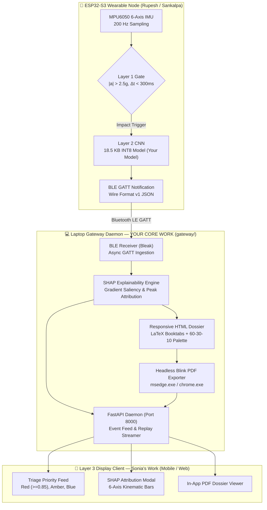

# SPARK — Aaradhya's Quick Start & Subsystem Briefing

**For:** Aaradhya Dev Tamrakar (Project Lead & Systems Architect / BEI)  
**Created:** October 25, 2026  
**Purpose:** Master subsystem briefing detailing leadership responsibilities, machine learning pipeline, TinyML quantization, gateway daemon, SHAP explainability engine, and academic thesis architecture.

---

## 1. What is SPARK & What is Your Ownership?

**SPARK** (*Signal Pattern Analysis & Real-time Kinetics*) is an edge-AI wearable fall detection and clinical explainability platform for the elderly. 

As **Project Lead & Systems Architect**, your ownership spans the mathematical, artificial intelligence, and host gateway infrastructure that ties the entire hardware-software ecosystem together:



---

## 2. Core Responsibilities & Subsystem Boundaries

| Subsystem Domain | Primary Deliverables | Assigned GitHub Issues |
| :--- | :--- | :--- |
| **Machine Learning & TinyML** | SisFall dataset preparation, 1D CNN training, leakage-free cross-validation, full INT8 post-training quantization, C-header export for ESP32-S3. | Issue #2, Issue #3, Issue #10 |
| **Gateway Daemon & Comms** | Asynchronous BLE GATT client (`bleak`), serial tether receiver, circular telemetry buffers, SQLite/JSON event indexing. | Issue #5 (Backend), Issue #12 |
| **Explainability Engine (SHAP)** | Gradient-based saliency ($X \times \nabla_X Y$), peak kinematic attribution, non-causal diagnostic notice, ADL vs. fall distinction. | **Issue #12** |
| **Clinical Reporting Suite** | Standalone HTML dossiers, inline SVG confidence whiskers, horizontal attribution tracks, headless Blink PDF export engine. | Issue #12 (Reports) |
| **Academic Thesis Architecture** | 41-page Mid-Defense & 46-page Final Defense LaTeX drafts, CPM critical path diagrams, defense slide decks. | Issue #10, Issue #13 |

---

## 3. Subsystem Interface Contracts

### Upstream Contract (Firmware → Gateway)
* **Owner:** Rupesh Kadel
* **Specification:** [`docs/WIRE_FORMAT_v1.md`](../WIRE_FORMAT_v1.md)
* **Transport:** BLE GATT Characteristic (`6E400003-B5A3-F393-E0A9-E50E24DCCA9E`) or USB-Serial at 921600 baud.
* **Payload:** Compact JSON frame containing `event_id`, `device_id`, `timestamp`, `confidence` (firmware softmax score), and `peak_features` ($a_x, a_y, a_z, \omega_x, \omega_y, \omega_z$).

### Downstream Contract (Gateway → Display Client)
* **Owner:** Sonia Thapa
* **Specification:** Local REST API at `http://<gateway-ip>:8000`
* **Endpoints:**
  * `GET /api/health` — Gateway status and BLE connectivity flag.
  * `GET /api/events` — Recent incident array with triage classification.
  * `GET /api/events/{id}` — Full event record with 6-axis normalized SHAP attributions.
  * `GET /api/reports/{id}` — Vector-crisp 1-page clinical PDF dossier.
  * `GET /api/reports/{id}.html` — Responsive standalone HTML dossier.

### Mechanical & Physical Alignment (Hardware ↔ ML)
* **Owner:** Sankalpa Lamsal
* **Mounting Reference:** Dorsal aspect of the wrist (top of wrist).
* **Kinematic Alignment:**
  * $a_z$: Deceleration shock normal to the forearm (primary vertical ground impact).
  * $a_y$: Lateral acceleration (side slips, lateral hip falls).
  * $a_x$: Longitudinal acceleration (forward stumbles, backward collapses).
  * $\omega$: Multi-axis angular velocity verifying posture collapse prior to ground shock.

---

## 4. Repository Map — Where Your Code Lives

```
SPARK/
├── training/                        ◄◄◄ ML & TINYML FORGE ◄◄◄
│   ├── prepare_sisfall.py           ← SisFall dataset processing & 200x6 windowing
│   ├── train_cnn.py                 ← 1D ConvNet training & Youden's J calibration
│   ├── quantize_model.py            ← Full INT8 post-training quantization & C export
│   ├── train_transfer.py            ← Nepal cohort transfer learning pipeline
│   ├── evaluate_shap.py             ← Held-out SHAP evaluation & ADL contrast
│   └── models/                      ← Saved Keras (.keras) and TFLite (.tflite) weights
│
├── gateway/                         ◄◄◄ GATEWAY & EXPLAINABILITY ◄◄◄
│   ├── main.py                      ← CLI entry point (supports null, replay, serial)
│   ├── server.py                    ← FastAPI daemon serving REST API & web dashboard
│   ├── receiver/                    ← Bleak BLE client & Serial stream readers
│   ├── shap_pipeline/
│   │   ├── explainer.py             ← CnnShapExplainer & PeakFeatureExplainer
│   │   └── shap_stub.py             ← Analytical fallback attribution
│   ├── report/
│   │   ├── html_report.py           ← 60-30-10 palette standalone clinical HTML dossier
│   │   ├── pdf_report.py            ← Direct PDF compilation & ReportLab fallback
│   │   └── pdf_exporter.py          ← Headless Blink engine discoverer & printer
│   └── storage/                     ← JSON event archive & indexing
│
├── docs/SPARK_Final_Defense/        ◄◄◄ THESIS & DEFENSE SUITE ◄◄◄
│   ├── main.tex                     ← Master 46-page Final Defense LaTeX document
│   ├── Chapters/                    ← Modular LaTeX chapters (Ch 1 to Ch 6)
│   └── Figures/                     ← Publication-grade vector diagrams & plots
│
└── dev_logs/SPARK_TRACKER.md        ◄◄◄ MASTER PROJECT TRACKER ◄◄◄
```

---

## 5. Defense Readiness: Faculty Panel Q&A

**Q: Why use a 1D CNN on the edge instead of an LSTM or Recurrent Neural Network?**  
> *"Recurrent networks (LSTMs/GRUs) maintain sequential hidden state dependencies that cannot be efficiently parallelized across SIMD registers. A 1D ConvNet with modest kernel sizes ($k=5, k=3$) processes temporal sliding windows with fixed feedforward latency (<15 ms on the ESP32-S3 at 240 MHz) and compiles to standard static memory buffers without dynamic allocation or exploding/vanishing gradients."*

**Q: How can a resource-constrained microcontroller compute SHAP attributions in real time?**  
> *"It doesn't. SPARK employs a two-tier cognitive division of labor. The ESP32-S3 runs strictly forward inference ($18.5\text{ KB}$ INT8 ConvNet). Upon confirming a fall, the telemetry frame is transmitted over BLE to the local laptop gateway, where the full floating-point gradient attribution engine computes input-times-gradient saliency (not Shapley values) without imposing compute or battery strain on the wearable."*

**Q: Why a two-layer architecture instead of running the AI model continuously?**  
> *"Layer 1 is a cheap magnitude check, $|a| = \sqrt{a_x^2 + a_y^2 + a_z^2}$ against a $2.5g$ threshold, run on every sample. Only windows that pass it invoke the CNN, so the classifier runs on a small fraction of windows instead of every stride. That reduces compute; whether it meaningfully extends battery life is unproven, because the always-on sampling, MCU baseline and BLE link likely dominate the current budget. Our endurance figure is an idealized C/I estimate (1100 mAh over an assumed 90–130 mA, about 8.5–12.2 h), not a measurement; per-mode current measurement is in the evaluation protocol."*
